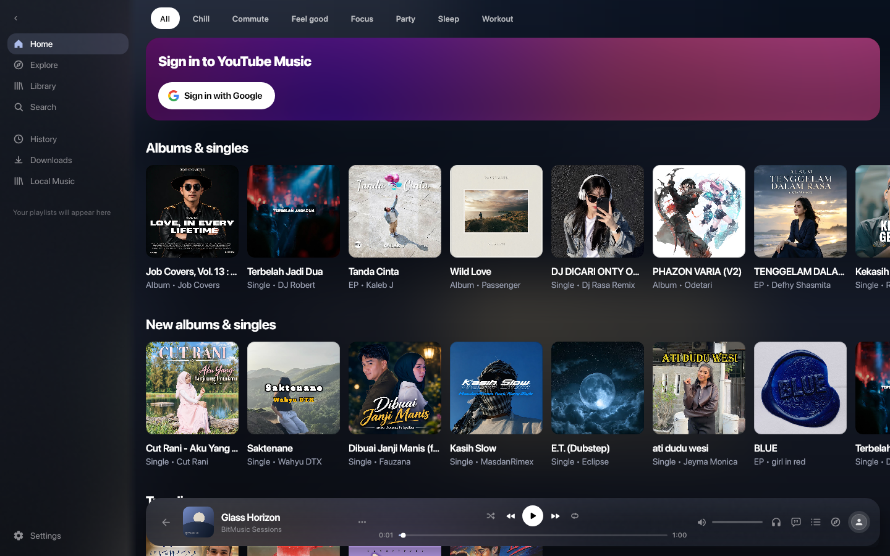
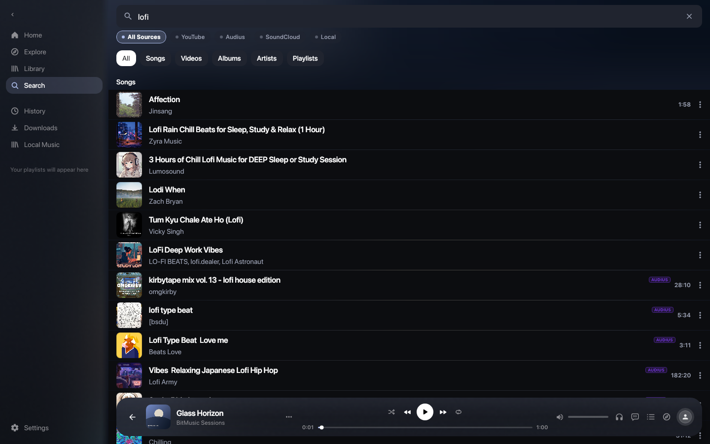
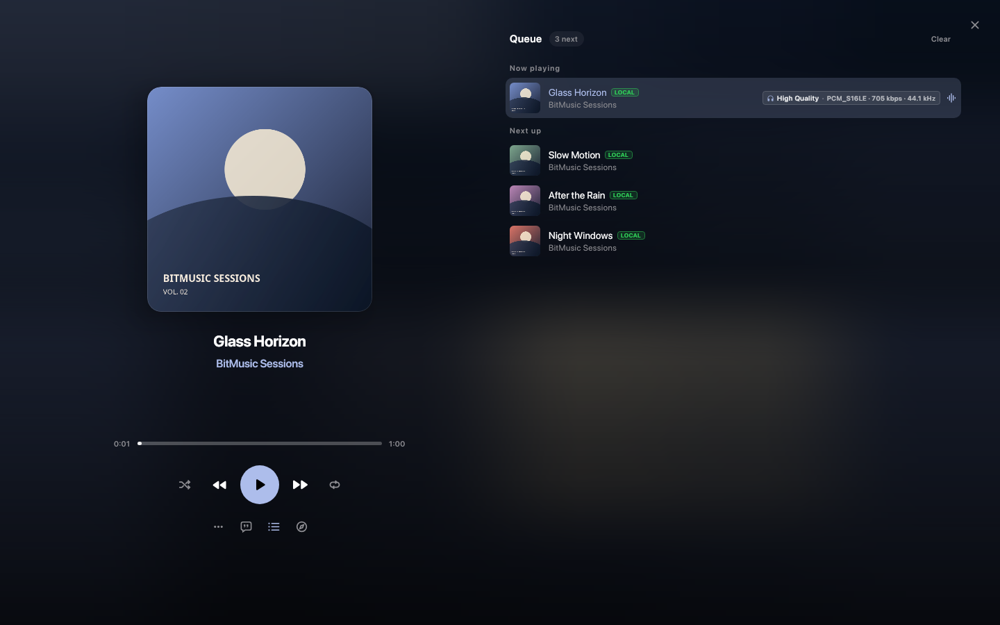
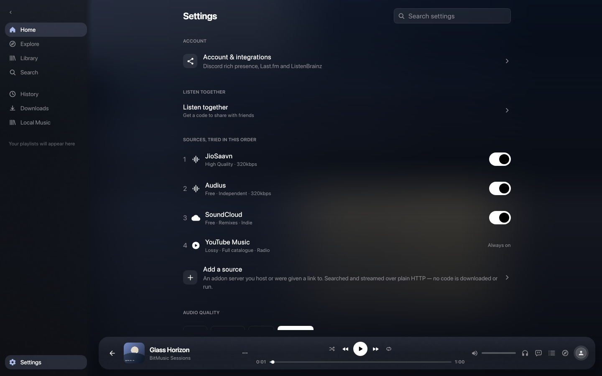
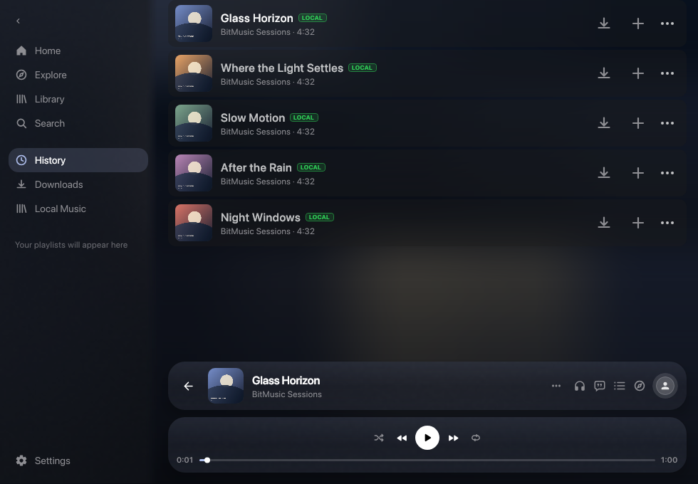

<p align="center">
  
</p>

# BitMusic

BitMusic is a high-fidelity YouTube Music client designed specifically for desktop: Linux, Windows, and macOS.

The project is an independent fork of [BitChord](https://github.com/kushagrasinghx/BitChord) by Kushagra Singh and contributors. BitMusic focuses on large desktop viewports, high-fidelity audio pipelines, and multi-source stream aggregation.

---

## Screenshots

<div align="center">

| Home & Floating Glass Player | Multi-Source Search (YouTube, Audius & SoundCloud) |
|:---:|:---:|
|  |  |

| Now Playing & Queue | Audio Sources & Settings |
|:---:|:---:|
|  |  |

<p><strong>Compact Desktop Window — Split Floating Player</strong></p>


</div>

Captured from the 1.4.2 desktop UI. Playback uses demo tracks and artwork; discovery and search show live public results.

---

## Supported Platforms

| Platform | Interface | Audio Pipeline | Distribution Formats |
|---|---|---|---|
| **Linux** | Compose Multiplatform Desktop | Native PulseAudio / PipeWire monitor capture + ALSA | `.AppImage`, `.deb`, `.rpm` |
| **Windows** | Compose Multiplatform Desktop | WASAPI loopback capture | `.exe` (installer), `.msi`, Portable `.zip` |
| **macOS** | Compose Multiplatform Desktop | CoreAudio capture | `.dmg` (Apple Silicon & Intel), `.pkg` |

---

## Core Capabilities

- **Desktop Audio Engine**: Low-latency capture with real-time spectrum analysis powered by native `cavacore` integration (PulseAudio/PipeWire on Linux, WASAPI on Windows, CoreAudio on macOS).
- **Playback Architecture**: Gapless track playback, configurable crossfade (0–12 seconds), and hardware-aligned audio buffers.
- **Synchronized Lyrics**: Word-level and line-level animated lyrics rendered with Skia/Skiko, with multi-provider fallback (LRCLIB, Musixmatch, Genius) and on-demand translation.
- **Account & Metadata Integration**: Google account login, Spotify playlist import, Discord Rich Presence, and scrobbling to Last.fm and ListenBrainz.
- **Party Synchronization**: Optional Listen Together party server (`backend/`) using monotonic clock synchronization over WebSockets.

---

## Quick Start

### Prerequisites
- **JDK**: Java Development Kit 21 (Eclipse Temurin 21 recommended).
- **Linux Audio Libraries (Linux only)**: PulseAudio / PipeWire development headers (`libpulse-dev`), ALSA (`libasound2-dev`), GTK3, and CMake.

### Running Locally
```bash
# Clone the repository
git clone https://github.com/1999AZZAR/BitMusic.git
cd BitMusic

# Run the desktop application
./gradlew :desktopApp:run
```

### Running Tests
```bash
./gradlew :desktopApp:test
```

### Building Packages
- **Linux deb package**:
  ```bash
  ./gradlew :desktopApp:packageDeb
  ```


For detailed platform guides and release packaging instructions, see:
- [Desktop Platform Guide](DESKTOP.md)

- [Release Protocol](docs/DESKTOP_RELEASES.md)

---

## Branch & Release Model

BitMusic uses a branch-aware versioning model. The current release base is `1.4.4`:

- `master`: Production release-ready code (`1.4.4`).
- `staging`: Ongoing development branch (`1.4.4-beta-0`, `-beta-1`, ...).
- `feature/<name>`: New feature branches created off `staging` (`1.4.4-beta-<name>-0`).

All contributions merge into `staging` via pull request before promotion to `master`. See [CONTRIBUTING.md](CONTRIBUTING.md).

---

## Upstream Origin & Credits

BitMusic is based on [BitChord](https://github.com/kushagrasinghx/BitChord), created by Kushagra Singh and contributors, licensed under the GNU General Public License v3.0. BitMusic maintains upstream attribution while redirecting development toward dedicated big-screen audio systems.

---

## License & Legal

This project is licensed under the **GNU General Public License v3.0 (GPLv3)**. See the [LICENSE](LICENSE) file for terms.

BitMusic is an independent open-source audio player. It is not affiliated with, endorsed by, or connected to Google LLC, YouTube, Deezer, Spotify, or Apple Inc. All product names, logos, and brands are property of their respective owners.
