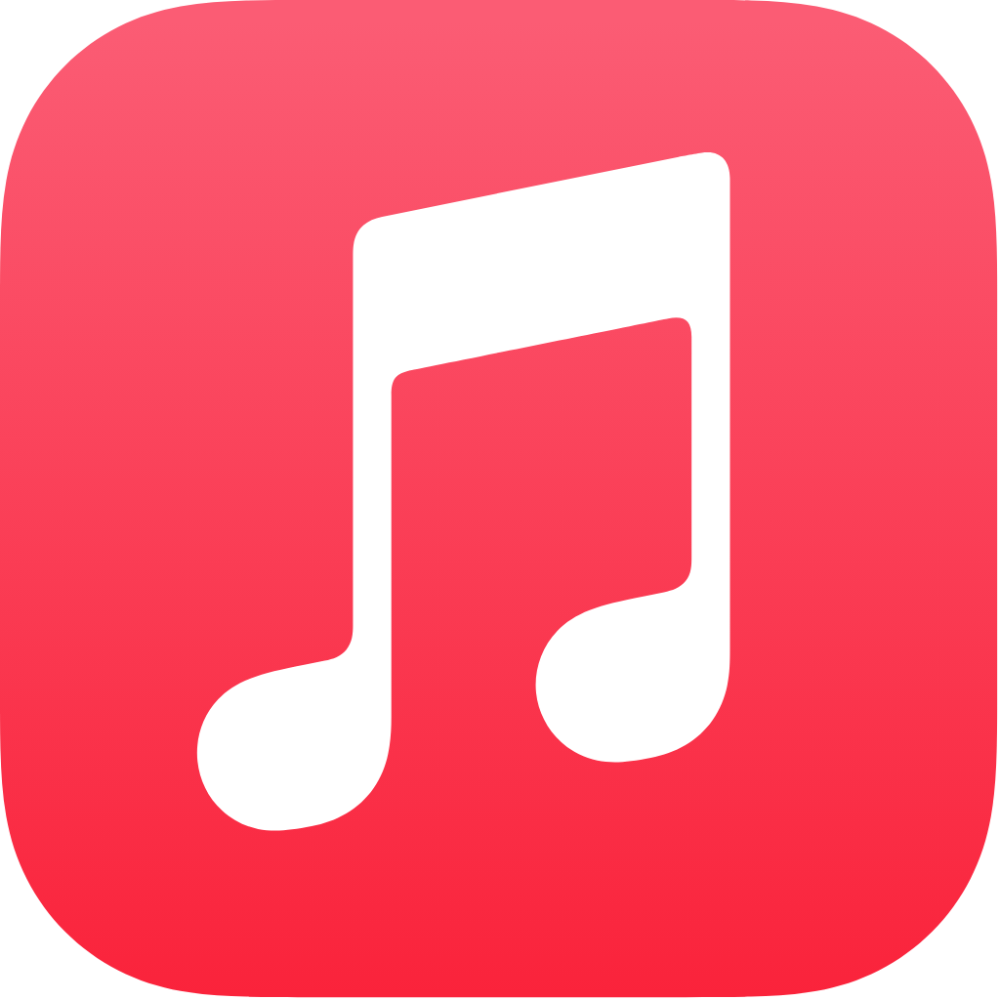

 
 

# BitMusic

### Aesthetic YouTube Music Client for Big Screens (Linux, Android TV, Windows, macOS)

 

[**Download**](#download) · [**Features**](#features) · [**Desktop Guide**](DESKTOP.md) · [**Android TV**](tv/README.md)

 

> [!IMPORTANT]
> BitMusic is a community-focused fork optimized for large screen experiences: Linux Desktop, Android TV, and desktop workstations. It is not affiliated with, endorsed by, or connected to YouTube or Google in any way.

> [!NOTE]
> **Credits & Origin:** BitMusic is an independent fork based on [BitChord](https://github.com/kushagrasinghx/BitChord) by Kushagra Singh and contributors, licensed under the GNU General Public License v3.0 (GPLv3). BitMusic decouples the codebase and redirects development specifically towards large display devices (Linux Desktop & Android TV), featuring a native low-latency Linux PulseAudio/PipeWire audio pipeline, decoupled native libraries, and streamlined TV packaging.

---

<h1>Features</h1>

<table>
  <tr>
    <td width="50%" valign="top">

#### Big Screen & Desktop Audio
- **Native Linux Audio Engine** — direct low-latency PulseAudio & PipeWire integration with real-time spectrum analysis.
- **Android TV Leanback UI** — remote D-pad navigation, QR code login, refresh rate switching, and spatial audio.
- **Hi-Res Lossless Audio** — FLAC/ALAC playback up to 192kHz/24-bit with YouTube Music fallback.
- **Gapless Playback & Crossfade** — true crossfade (0–12s) with hardware-aligned buffers.
- **Automix DJ Transitions** — beat-matching and tempo-stretching powered by native ONNX runtime.
- **Desktop MPRIS2 & Notifications** — seamless Linux desktop integration with system tray and media keys.

#### Connectivity & Accounts
- **Sign in with your Google account** for personalized content and subscriptions.
- **Spotify integration** — connect your account to play your playlists and Liked Songs.
- **Discord Rich Presence** — in-app login, live track/artist/album and progress.
- **Scrobbling** to Last.fm and ListenBrainz.
- **Pluggable sources** — add, edit, test and health-check module sources.

    </td>
    <td width="50%" valign="top">

#### Large Display Visuals
- **Apple-Style Synchronized Lyrics** — word- and syllable-level animated highlights rendered with Skia/Skiko.
- **Animated Album Canvas** — full-screen motion artwork on large screens.
- **Dynamic Artwork-Driven Theming** — vibrant palettes automatically extracted from album art.
- **Frosted-Glass UI** — translucent panels and Material 3 design crafted for large viewports.
- **Lyrics Providers** — [LRCLIB](https://lrclib.net), [Musixmatch](https://www.musixmatch.com), [Genius](https://genius.com), [lrc.red](https://lrc.red), and more.

#### Controls & Tweaks
- **Stats for Nerds** — codec, bit depth, sample rate, and buffer metrics.
- **Playback speed control** (0.5×–2.0×) and **skip silence**.
- **Sleep timer** — fixed presets or "stop after this track".
- **Equalizer** integration and spatial audio modes.

    </td>
  </tr>
</table>

---

<h1>Download</h1>

BitMusic is built for big screen environments. Pre-packaged releases are available with bundled Java runtimes, FFmpeg, and ONNX models:

| Platform | Format | Description |
|---|---|---|
| **Linux Desktop** | `.AppImage` / `.deb` / `.rpm` | High-performance desktop client with native PulseAudio/PipeWire support. See [DESKTOP.md](DESKTOP.md). |
| **Android TV** | `.apk` (Universal / Leanback) | Remote-first interface for Google TV and Android TV boxes. See [tv/README.md](tv/README.md). |
| **Windows Desktop** | `.exe` / `.msi` / Portable `.zip` | Windows 10/11 desktop app with WASAPI audio. |
| **macOS Desktop** | `.dmg` / `.pkg` / `.zip` | Apple Silicon (M-series) & Intel builds with CoreAudio. |

---

<h1>Contributing</h1>

We welcome contributions to BitMusic! Please review our [Contributing Guide](CONTRIBUTING.md) and [Code of Conduct](CODE_OF_CONDUCT.md) before submitting a Pull Request.

[**Contributing Guide**](CONTRIBUTING.md) · [**Code of Conduct**](CODE_OF_CONDUCT.md)

---

<h1>Disclaimer & Legal Notice</h1>

BitMusic is an independent, community-driven third-party audio player and client. It is **not** associated with Google LLC, YouTube Music, Deezer, Telegram, or any of their parent companies.

* **No Media Hosting:** BitMusic does not host, upload, or store copyrighted music files. It operates strictly as an interface to scan local device storage or stream media directly from public, public-facing, or user-authenticated APIs.
* **Fair Use & API Usage:** This software is created solely for personal research, educational, and fair-use purposes. The user is entirely responsible for ensuring their usage aligns with their local copyright laws and YouTube Terms of Service.
* **No Ad-Blocking Guarantee:** While BitMusic focuses on providing a clean listening environment, it does not guarantee permanent bypasses or modifications to commercial third-party platform conditions.
* **Copyleft:** BitMusic is free software under the GPLv3. The license does not let anyone forbid others from selling or redistributing copies, but any distribution must come with the Corresponding Source under the same license.

---

<h1>License</h1>

This project is licensed under the **GNU General Public License v3.0 (GPLv3)**. See the [LICENSE](LICENSE) file for details.

