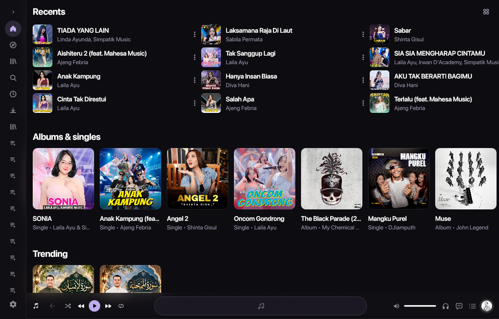
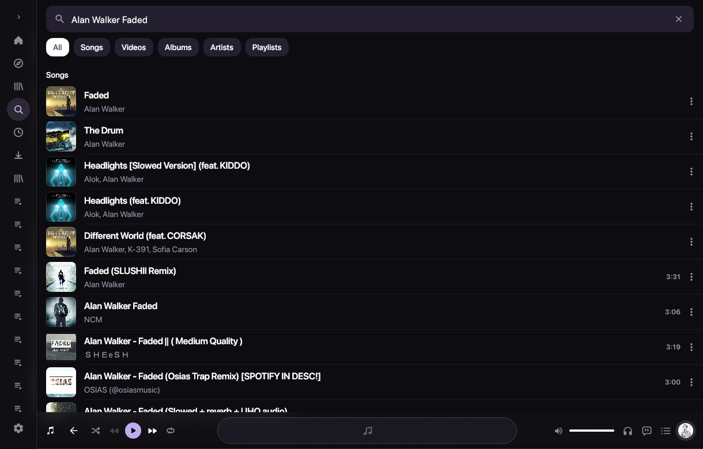
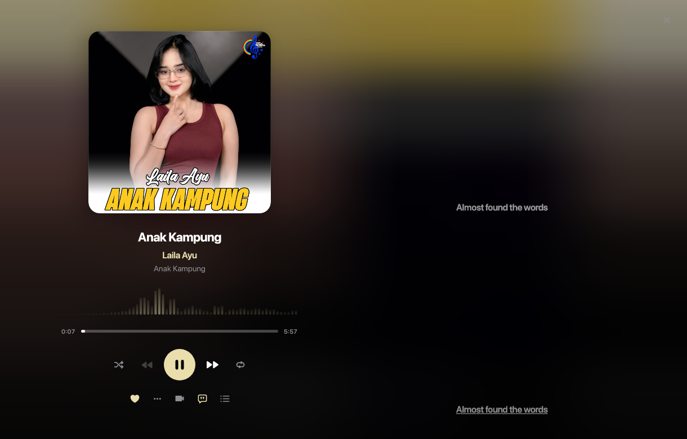
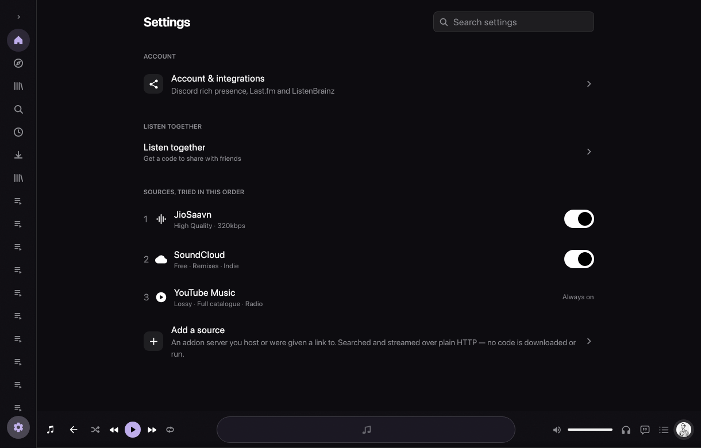

<p align="center">
  
</p>

# BitMusic

BitMusic is a high-fidelity YouTube Music client designed specifically for large displays: Linux desktop, Android TV, Windows, and macOS.

The project is an independent fork of [BitChord](https://github.com/kushagrasinghx/BitChord) by Kushagra Singh and contributors. BitMusic decouples the core codebase from mobile phones to focus entirely on large viewports, high-fidelity desktop audio pipelines, multi-source stream aggregation, and remote-driven television interfaces.

---

## Screenshots

<div align="center">

| Discover & Home Dashboard | Multi-Source Search (YouTube + SoundCloud) |
|:---:|:---:|
|  |  |

| Now Playing & Synchronized Lyrics | Audio Sources & Routing Settings |
|:---:|:---:|
|  |  |

</div>

---

## Supported Platforms

| Platform | Interface | Audio Pipeline | Distribution Formats |
|---|---|---|---|
| **Linux** | Compose Multiplatform Desktop | Native PulseAudio / PipeWire monitor capture + ALSA | `.AppImage`, `.deb`, `.rpm` |
| **Android TV** | Compose for TV (`androidx.tv.material3`) | Android Media3 / ExoPlayer (Leanback D-pad remote) | `.apk` (Universal Leanback) |
| **Windows** | Compose Multiplatform Desktop | WASAPI loopback capture | `.exe` (installer), `.msi`, Portable `.zip` |
| **macOS** | Compose Multiplatform Desktop | CoreAudio capture | `.dmg` (Apple Silicon & Intel), `.pkg` |

---

## Core Capabilities

- **Desktop Audio Engine**: Low-latency capture with real-time spectrum analysis powered by native `cavacore` integration (PulseAudio/PipeWire on Linux, WASAPI on Windows, CoreAudio on macOS).
- **Android TV Interface**: Full remote D-pad navigation, focus management, display refresh-rate switching, and QR-code authentication from a phone.
- **Playback Architecture**: Gapless track playback, configurable crossfade (0–12 seconds), and hardware-aligned audio buffers.
- **Synchronized Lyrics**: Word-level and line-level animated lyrics rendered with Skia/Skiko, with multi-provider fallback (LRCLIB, Musixmatch, Genius) and on-demand translation.
- **Account & Metadata Integration**: Google account login, Spotify playlist import, Discord Rich Presence, and scrobbling to Last.fm and ListenBrainz.
- **Party Synchronization**: Optional Listen Together party server (`backend/`) using monotonic clock synchronization over WebSockets.

---

## Quick Start

### Prerequisites
- **JDK**: Java Development Kit 21 (Eclipse Temurin 21 recommended).
- **Linux Audio Libraries (Linux only)**: PulseAudio / PipeWire development headers (`libpulse-dev`), ALSA (`libasound2-dev`), GTK3, and CMake.

### Running Locally
```bash
# Clone the repository
git clone https://github.com/1999AZZAR/BitMusic.git
cd BitMusic

# Run the desktop application
./gradlew :desktopApp:run
```

### Running Tests
```bash
./gradlew :desktopApp:test
```

### Building Packages
- **Linux deb package**:
  ```bash
  ./gradlew :desktopApp:packageDeb
  ```
- **Android TV debug APK**:
  ```bash
  ./gradlew :tv:assembleDevDebug
  ```

For detailed platform guides and release packaging instructions, see:
- [Desktop Platform Guide](DESKTOP.md)
- [Android TV Guide](tv/README.md)
- [Release Protocol](docs/DESKTOP_RELEASES.md)

---

## Branch & Release Model

BitMusic uses a branch-aware versioning model with base version `1.1.0`:

- `master`: Production release-ready code (`1.1.0`, `1.1.1`, ...).
- `staging`: Ongoing development branch (`1.1.0-beta-0`, `-beta-1`, ...).
- `feature/<name>`: New feature branches created off `staging` (`1.1.0-beta-<name>-0`).

All contributions merge into `staging` via pull request before promotion to `master`. See [CONTRIBUTING.md](CONTRIBUTING.md).

---

## Upstream Origin & Credits

BitMusic is based on [BitChord](https://github.com/kushagrasinghx/BitChord), created by Kushagra Singh and contributors, licensed under the GNU General Public License v3.0. BitMusic maintains upstream attribution while redirecting development toward dedicated big-screen audio systems.

---

## License & Legal

This project is licensed under the **GNU General Public License v3.0 (GPLv3)**. See the [LICENSE](LICENSE) file for terms.

BitMusic is an independent open-source audio player. It is not affiliated with, endorsed by, or connected to Google LLC, YouTube, Deezer, Spotify, or Apple Inc. All product names, logos, and brands are property of their respective owners.
